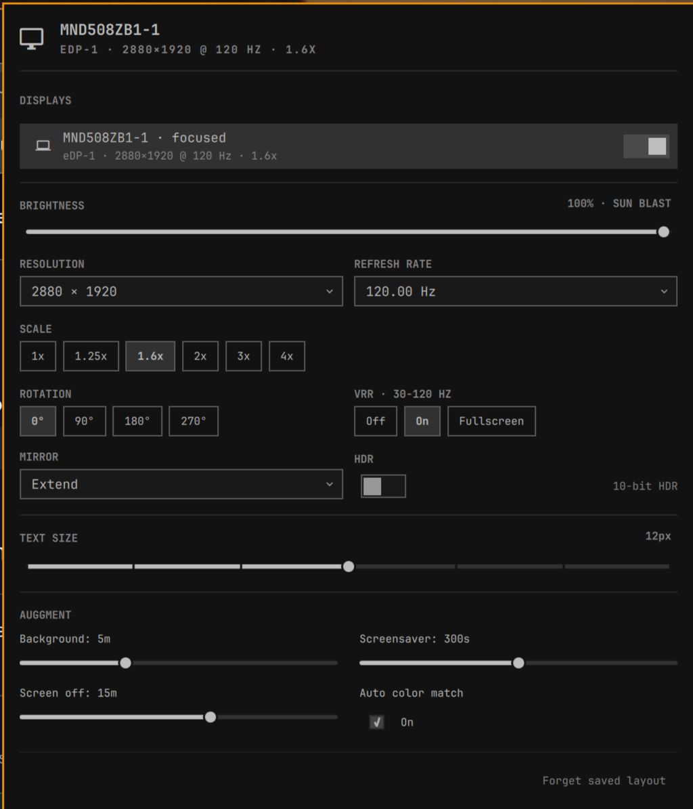

# Auggment Display

Full monitor control for Omarchy — resolution, arrangement, refresh rate, scale,
rotation, mirroring, VRR, HDR and brightness, per display — plus wallpaper
rotation, a screen-off timer and wallpaper-derived color matching.

This is a fork of [**Advanced Displays**](https://github.com/Fluffet/omarchy-advanced-displays)
by [Fredrik Öhrström (Fluffet)](https://github.com/Fluffet), used and extended
under the MIT license. All of the display configuration is their work; the
Auggment additions are the background/power/color section. Thanks, Fluffet.

<p align="center">
  
</p>

## Installation

```bash
omarchy plugin add https://github.com/auggnation/omarchy-auggment-display --enable
omarchy plugin disable omarchy.monitor
```

The second line hides the built-in Display widget, so you don't get two icons.
Click the new icon in your bar.

### Dependencies

The plugin is self-contained — the helper scripts live in `bin/` and are invoked
directly, so nothing is installed and no service is registered by the plugin.
A few optional external tools enable the Auggment extras; each feature simply
does nothing if its tool is missing:

- **`hypridle`** — required for the *Screen off* timer.
- **`pywal`** / **`wal`** (package `pywal16`) — required for *Auto color match*.
- **`jq`** — required to change the *Screensaver* timeout.

Install these with your package manager if you want those features.

## What the Auggment section adds

Below the per-monitor controls, the panel gains:

- **Background** — rotate through the current theme's wallpapers on an interval,
  randomly and without repeating recent picks.
- **Screensaver** — how long before the screensaver starts (writes `idle.screensaver`).
- **Screen off** — turn the display off after N minutes via `hypridle` (dpms), and
  back on when you return. Generates `~/.config/hypr/hypridle.conf` and reloads the daemon.
- **Auto color match** — derive the whole theme palette from the current wallpaper
  with `pywal` and apply it live, window borders included.

Settings are stored under `~/.config/auggment/`.

## What this plugin writes

Nothing is changed until you move a control. When you do, the plugin only
touches the specific file that control is about:

| Control | File | Notes |
| --- | --- | --- |
| Per-monitor settings (**Keep**) | `~/.config/hypr/monitors.lua` | Written inside a `BEGIN`/`END Auggment` block; other content is left intact. |
| Screensaver | `~/.config/omarchy/shell.json` | Only the `idle.screensaver` key is changed, via a private same-directory temp file; the file's mode and owner are preserved. |
| Screen off | `~/.config/hypr/hypridle.conf` | Regenerated with an Auggment marker. If you already have a `hypridle.conf` that Auggment does not manage, it is backed up to `hypridle.conf.auggment.bak` first. |
| Auto color match | `~/.config/omarchy/themes/auggment/colors.toml`, the live theme under `~/.local/state/omarchy/current/theme/` | Rewrites the palette derived from the wallpaper. Off by default. |
| Background / Screensaver / Screen off intervals | `~/.config/auggment/` | The plugin's own settings directory. |

## Two things to know

**Changes apply live, but revert after 15 seconds.** Press **Keep** to save.

**Keep writes to `~/.config/hypr/monitors.lua`.**

Settings are stored per monitor, not per port. Move the cable, settings follow.

## Rebind SUPER + CTRL + D

That key opened the built-in panel, which is now off. Point it here instead, in
`~/.config/hypr/bindings.lua`:

```lua
hl.unbind("SUPER + CTRL + D")
o.bind("SUPER + CTRL + D", "Display", "omarchy-shell io.github.auggnation.auggment-display toggle")
o.bind("SUPER + CTRL + SHIFT + D", "Arrange displays", "omarchy-shell shell toggle io.github.auggnation.auggment-display")
```

## Removal

```bash
omarchy plugin remove io.github.auggnation.auggment-display
```

Press **Forget saved layout** in the panel first if you also want your monitor
settings gone. Otherwise the Auggment block in `monitors.lua` stays.

To also remove the Auggment settings and the managed screen-off config:

```bash
rm -rf ~/.config/auggment
rm -f ~/.config/hypr/hypridle.conf
```

If a `hypridle.conf.auggment.bak` backup was created, restore or delete it too.
To restore the built-in Display widget you disabled during installation:

```bash
omarchy plugin enable omarchy.monitor
```

<details>
<summary>Small print</summary>

- HDR only appears if the monitor's EDID says it supports it.
- VRR shows the EDID refresh range as a hint.
- Brightness uses the backlight on laptops, DDC on desktop monitors.
- Move the widget like any other: `omarchy bar move io.github.auggnation.auggment-display --section right`

</details>

<details>
<summary>Scripting (IPC)</summary>

```bash
omarchy-shell io.github.auggnation.auggment-display toggle
omarchy-shell io.github.auggnation.auggment-display state
omarchy-shell io.github.auggnation.auggment-display select DP-3
omarchy-shell io.github.auggnation.auggment-display change '{"hz":60}'   # keys: width height hz scale transform mirror vrr hdr disabled
omarchy-shell io.github.auggnation.auggment-display keep
omarchy-shell io.github.auggnation.auggment-display revert
omarchy-shell io.github.auggnation.auggment-display forget
```

</details>

<details>
<summary>Hacking on it</summary>

```bash
ln -s "$PWD" ~/.config/omarchy/plugins/io.github.auggnation.auggment-display
omarchy plugin enable io.github.auggnation.auggment-display
node --test test/model.test.js
bash test/monitors-lua.test.sh
shellcheck monitors-lua.sh
qmllint -I "$OMARCHY_PATH/shell" Panel.qml
```

Hot reload through a symlinked plugin dir is unreliable. `omarchy restart shell` always works.

</details>

## Credits & license

- Original **Advanced Displays** © 2026 Fredrik Öhrström (Fluffet) — MIT.
- **Auggment** additions © 2026 Auggment — MIT.

See [LICENSE](LICENSE) for the full text.
